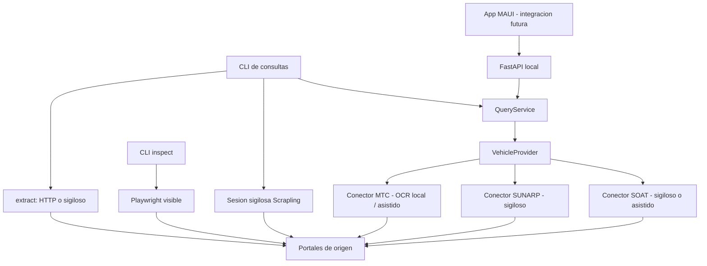

# Arquitectura de OBD Consultas

## Alcance

Un proceso local de Python, con conectores independientes para cada fuente y dos
entradas: CLI y HTTP. La app MAUI conserva el diagnostico OBD y podra consumir esta
API para los papeles del vehiculo. No necesita conocer formularios ni proveedores.

No se agregan cuentas, creditos, pagos, colas ni base de datos en esta etapa.



## Responsabilidades y dependencias

| Modulo | Responsabilidad |
|---|---|
| domain | Contratos y reglas sin dependencias externas |
| domain/models | `Source`, `QueryMode` (`basic`, `stealth`, `assisted`), `QueryStatus`, `QueryResult` |
| application | `QueryService.run(source, plate, mode)`: normaliza, valida modo y timeout, despacha |
| providers | Parsers por fuente y `VehicleProvider` (modo `basic`, sin navegador) |
| infrastructure | Captura por portal: `<fuente>_stealth.py`, `<fuente>_browser.py` |
| infrastructure/connector_common | Lo compartido: timeout, JSON seguro, sello de captura, errores de sesion |
| infrastructure/scrapling_engine | Envoltura de Scrapling: sesion sigilosa, HTTP y parser |
| infrastructure/extraction | Reglas declarativas de extraccion y Markdown |
| api | Validar peticiones HTTP y serializar resultados |
| cli | Comandos, salida JSON y servidor local |
| bootstrap | Registro de providers y de runners por `(fuente, modo)`, con import diferido |

El dominio no importa FastAPI ni Playwright. La CLI y la API **solo** hablan con
`QueryService`: no importan modulos de `infrastructure/` ni tienen `if source == ...`.
Las fuentes que admite cada modo salen de `QueryService.modes()` / `sources_for()`,
y `/v1/sources` las expone en `modes` para que la APK no las codifique. Los selectores, cookies y parsers de cada web
perteneceran al conector de esa fuente. No se inventan selectores antes de inspeccionar.

## Contrato de consulta

`POST /v1/queries`

```json
{"source": "soat", "plate": "ABC123"}
```

Respuesta de `/v1/queries` para MTC (contrato basico, sin consultar):

```json
{
  "source": "mtc",
  "plate": "ABC123",
  "status": "requires_interaction",
  "source_url": "https://portal.mtc.gob.pe/reportedgtt/form/frmconsultaplacaitv.aspx",
  "message": "MTC requiere un captcha de imagen: usa --interactive o /v1/queries/assisted.",
  "data": {},
  "queried_at": "2026-11-21T00:00:00+00:00"
}
```

`not_implemented` se reserva para fuentes futuras sin extractor.

La fecha del ejemplo es ilustrativa. La respuesta real usa la hora UTC de la consulta.
El esquema de `data` para SOAT esta documentado en [SOAT.md](SOAT.md) y el de SUNARP
en [SUNARP.md](SUNARP.md) y el de MTC en [MTC.md](MTC.md). Los tres son estables
para consumir desde la app local.

SUNARP no devuelve los datos del vehiculo como campos JSON: entrega una imagen PNG
de la tarjeta TIVE. El conector la valida y la expone en `data.tarjeta`; no se hace
OCR ni se inventan campos. La imagen puede contener datos del propietario.

| Estado | Significado |
|---|---|
| success | Resultado real obtenido y parseado correctamente |
| not_found | La fuente indica explicitamente que no encontro registros |
| requires_interaction | El portal exige una accion manual |
| unavailable | La fuente no responde o esta temporalmente indisponible |
| parse_error | El contenido cambio o no se puede interpretar |
| not_implemented | Todavia no existe extractor para esa fuente |

Un fallo de red, bloqueo o pagina inesperada nunca debe convertirse en `not_found`
ni en una afirmacion de que el vehiculo no tiene problemas.
HTTP 200 indica que se devolvio un resultado estructurado: el consumidor debe leer
`status`. Peticiones invalidas reciben 422; errores inesperados del programa, 500.
`/health` comprueba el proceso, no la disponibilidad de los portales.

## Navegador y extraccion

La inspeccion manual y las consultas son caminos separados. `inspect` abre un contexto
temporal en un navegador visible y usa Playwright Inspector. Al terminar cierra contexto
y navegador. No persiste cookies, HTML ni respuestas.

Scrapling es el motor de scraping y se usa como dependencia (BSD-3-Clause); no se
copia su codigo. `infrastructure/scrapling_engine.py` concentra su API:

- `StealthySession` para portales con JavaScript o Cloudflare (SOAT).
- `Fetcher` para HTTP rapido con huella TLS de Chrome, cuando no hace falta navegador.
- `parse_html` para CSS/XPath, pseudoelementos y selectores adaptativos.
- Proxies, reintentos y perfil de navegador opcionales.

El modo sigiloso conduce el formulario oficial: no extrae ni reutiliza tokens de
Turnstile. Si el reto no se resuelve o el resultado no llega, devuelve
`requires_interaction` o `unavailable`, nunca `not_found`.

`infrastructure/extraction.py` permite describir filas con `Field` y obtener
registros o tablas sin repetir CSS. Se usa para leer capturas y para los futuros
conectores. Los selectores de un portal se escriben despues de inspeccionarlo.

Cada futuro conector elegira HTTP directo o navegador segun el flujo observado.
Las consultas tendran tiempo limite. `POST /v1/queries` no abre navegadores ni
consulta: solo valida y responde `requires_interaction`. El puente
`POST /v1/queries/stealth` encola la misma consulta sigilosa de la CLI en un hilo
de la PC y publica el resultado en `GET /v1/jobs/{id}`. Para MTC existe
`POST /v1/queries/assisted`, que abre el navegador visible para que una persona
resuelva el captcha. Ver [API.md](API.md).

El inventario de fuentes objetivo, sus estados y el orden sugerido estan en
[PLAN.md](PLAN.md).

## Como implementar una fuente

1. Inspeccionar el formulario y verificar como se entrega el resultado.
2. Agregar el valor a `Source` y su `SourceInfo` a `providers/catalog.py`.
3. Crear `providers/<fuente>.py`: parser puro (`result_from_response`), fabrica
   `<fuente>_result` y un provider con `info` y `query(plate)` (modo `basic`).
4. Crear `infrastructure/<fuente>_stealth.py` con `query_<fuente>_stealth(plate, timeout, **opciones)`.
   Usar `connector_common` (`validate_timeout`, `guarded`, `stealth_options`,
   `result_from_api`, `result_from_error`, `session_failure`) y dejar en el modulo
   solo lo propio del portal: selectores, `_observe` y `_result_from_holder`.
5. Registrar en `bootstrap.py`: el provider en `PROVIDERS` y cada modo en `RUNNERS`
   con `_lazy("<fuente>_stealth", "query_<fuente>_stealth")`. CLI y API lo toman solas.
6. Tests con fixtures sinteticos del parser y de `_result_from_holder`; actualizar
   `test_bootstrap_mode_matrix`.
7. Probar con una placa autorizada, documentar en `docs/<FUENTE>.md` y marcar
   `implemented=True` solo cuando el conector consulte realmente la fuente.

Las tres fuentes estan implementadas y pueden ejecutarse de forma desatendida.
MTC usa OCR local (`ddddocr`) sobre el captcha de imagen, con reintentos
limitados y modo asistido como respaldo. La consulta basica de SUNARP no se asume
equivalente a un historial registral completo ni se promete el mismo contenido
que ApisTED.

## Datos y despliegue

Actualmente los resultados viven solo en memoria y en la salida solicitada por el usuario.
No se guarda historial ni se habilita cache: asi no se entrega vigencia antigua como actual.
No registrar placas completas, propietarios, cookies o cuerpos de respuestas en logs.
La tarjeta TIVE de SUNARP puede incluir nombres de propietarios: se entrega solo en
la salida solicitada y no se escribe en disco ni en logs.
Los logs de acceso de Uvicorn estan desactivados en el comando `serve`; los INFO de
Scrapling se bajan a WARNING.

El modo sigiloso no guarda cookies ni sesiones salvo que se pase `--profile`. Los
proxies son opcionales (`OBD_PROXY_URL`, `OBD_PROXY_ROTATION`) y no se escriben en
disco. El servidor escucha en `127.0.0.1` por defecto. Para exponerlo en la LAN se
usa `serve --host 0.0.0.0` y hace falta definir `OBD_API_TOKEN`; las rutas `/v1/*`
exigen entonces la cabecera `X-OBD-Token`. Es HTTP sin cifrar: solo redes de
confianza. Los trabajos viven en memoria (maximo 100) y desaparecen al reiniciar.
El asistido no se expone por API. Ver [API.md](API.md).

Si mas adelante se necesita historial, SQLite sera suficiente como primera opcion;
se definiran antes retencion, procedencia y fecha de cada dato. No es requisito para
probar el primer extractor.

## Referencias tecnicas

- FastAPI: https://fastapi.tiangolo.com/tutorial/response-model/
- Playwright: https://playwright.dev/python/docs/api/class-browser

## Avance SOAT

El parser, la consulta asistida y la consulta desatendida estan implementados.
La entrada CLI usa `infrastructure/soat_stealth.py` (Scrapling) o
`infrastructure/soat_browser.py` (Playwright visible) para obtener la respuesta del
formulario; luego `providers/soat.py` la normaliza. `/v1/queries` devuelve
`requires_interaction`; el puente sigiloso de la API usa el mismo conector que la
CLI. No se comparten sesiones entre consultas.
El 20/11/2026 el modo desatendido obtuvo un resultado real sin intervencion y fue
normalizado; no se guardaron datos. Ver [SOAT.md](SOAT.md) y [SCRAPLING.md](SCRAPLING.md).

## Avance SUNARP

El conector esta implementado en modo desatendido. La CLI usa
`infrastructure/sunarp_stealth.py` (Scrapling) para conducir el formulario Angular,
observar la respuesta de `getDatosVehiculo` y, si hace falta, leer la tarjeta
visible. `providers/sunarp.py` valida la imagen PNG, las sedes y la placa, y
normaliza el resultado. `infrastructure/sunarp_ocr.py` lee la tarjeta TIVE con
RapidOCR local y expone los campos en `data.vehiculo`, conservando la imagen
oficial y la confianza por campo. `/v1/queries` devuelve `requires_interaction`;
`/v1/queries/stealth` ejecuta el mismo flujo en segundo plano y entrega la tarjeta
por HTTP. El 23/11/2026 se valido el flujo completo con una placa autorizada;
los datos no se guardaron. Ver [SUNARP.md](SUNARP.md).

## Avance MTC

El conector desatendido `infrastructure/mtc_stealth.py` abre una sesion HTTP,
pide el captcha y lo resuelve con `ddddocr` local, reintentando con imagenes
nuevas si el portal lo rechaza. `infrastructure/mtc_browser.py` conserva el modo
asistido como respaldo. `providers/mtc.py` normaliza hasta tres registros de
revision tecnica. La API ofrece `/v1/queries/stealth` para MTC y mantiene
`/v1/queries/assisted` como alternativa. El 23/11/2026 se valido el flujo real
con una placa autorizada en ambos modos. Ver [MTC.md](MTC.md).
